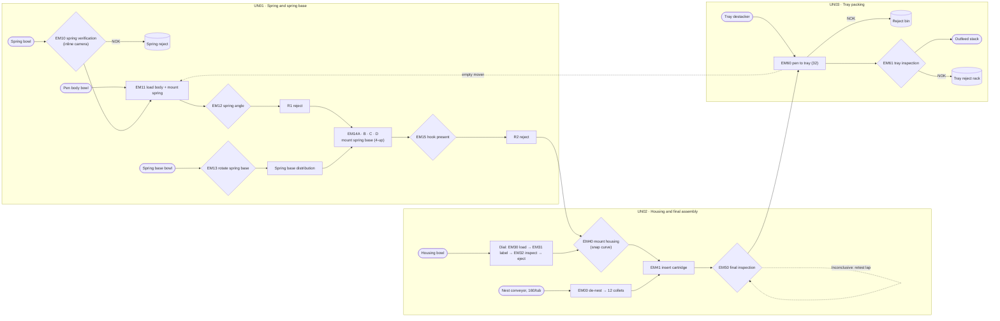

# Pen Assembly Line Simulator: Plan v2, the full line (draft 2026-11-17)

v1 (`docs/PLAN.md`) built a physical 3D line: plant, PLC, MES, faults, batches, CATCH.AI,
server streaming, cameras and RTSP. To get there it simplified the C# `IrAssemblySimulatorService`
a lot. v2 brings back **everything the original models** and keeps everything v1 built. Nothing
teleports, cycle times still emerge from physics, and the line still runs as one server process
streamed to every browser.

## 0. Decisions to confirm (recommended defaults in bold)

| # | Question | Recommendation | Alternative |
| --- | --- | --- | --- |
| D1 | Station names | **Original EM numbers in units: `L07-UN01-EM11`, …** (data looks like the C# line's) | Keep ST10…ST70 |
| D2 | Line id | **Keep `L07`**, configurable, so it can share a CATCH.AI server with the C# `L06` | `L06` |
| D3 | Quality parameters | **The original's means, σ and limits**, including the EM14B outlier (~30 % fails there) and bad movers 2/6/24. The line rejects ~10–12 % | Tamed to the v1 target of ~5 % |
| D4 | Pen identifier | **On the housing label printed at EM31** (as `AddIdentifier` in the original). This drops the laser mark on the body and the cap | Keep the laser mark on the body too |
| D5 | Four parallel EM14 | **4-up group in series on one belt** (generalizes the twin ST40; keeps mover order like the original's `SimCarriers`) | Diverter onto two lanes with a merge (later option, §4) |
| D6 | Batch size | **Counted in trays passed by EM61** (like `IsLastProcess`), with fill-to-count so the last tray is full | Pens loaded (v1) |
| D7 | Snap curve data | **1 kHz like the original** (~600 device-data rows per pen, configurable) | Decimated to 100–200 Hz |

## 1. What changes, original vs v1 vs v2

| Original (C#) | v1 | v2 |
| --- | --- | --- |
| EM00 de-nest, 160 cartridges per nest, 12 collets | Nest of 24 per twin station | Tub of 160 (10×16) on a nest conveyor, de-nest robot fills **12 collets** on a carousel that feeds EM41 |
| EM10 spring verification (off-carrier) | – | Inline camera on the spring track, air-jet blow-off of bad springs |
| EM11 mount spring (gets a mover) | ST10 load body + ST20 spring | EM11 cell: body robot + spring robot on one gate |
| EM12 measure spring angle | ST30 | EM12 camera |
| EM13 rotate spring base | – | Orienter: vision + rotary gripper, feeds a distribution conveyor along EM14 |
| EM14A–D mount spring base (B fragile/outlier) | Twin ST40A/B (cartridge) | **4-up EM14A–D** press with seating force, per-station bias, B fragile |
| EM15 spring hook present | – | EM15 camera |
| EM30 housing infeed / EM31 label / EM32 label inspection | Housing feeder | **Housing dial table**: load, label applicator (prints GS1 DataMatrix), label camera, eject, unload |
| EM40 mount housing + snap curve (logged on housing) | ST50 housing + cap, snap value | EM40 with a real force/displacement curve, logged on the housing item |
| EM41 insert cartridge (after housing) | ST40A/B (before housing) | EM41 from collets |
| EM50 final inspection | ST60 final vision + code | EM50: measurement + code check + **Inconclusive → retest lap** |
| EM60 pen to tray, 32 per tray, frees the mover | ST70, 12 per tray | EM60, tray 4×8 from a **tray destacker** |
| EM61 tray inspection (last process) | – | Tray conveyor → EM61 camera → outfeed stack or reject rack |
| Bad carriers 2, 6, 24 | Worn movers (physics) | Both: physical profiles **and** the original's carrier badness |
| Fragile count shifts inspections by 0.15σ each | Fragile shifts seat depth only | Original rule on every downstream inspection |
| `ItemResult.Inconclusive`, eject rate (unused in the original) | – | Used at EM50: one retest per item |
| Reject causes per process | One cause per limit | Original cause lists, chosen from the actual failure mode where physics allows |

## 2. The line

**Mover loop:** EM11, EM12, R1, EM14A–D, EM15, R2, EM40, EM41, EM50, EM60. That's 13 gates
compared with 9 today, so the loop grows to about 2 × 7 m straights (≈ 16.5 m). It keeps 32
movers (configurable). Everything off the loop is a **sub-line** with its own conveyors and
shift-register tracking: springs, spring bases, the housing dial, nests and collets, trays.

**Rejects:** inspections write NOK to the tag, as in v1. Removal happens at R1 (before the
expensive spring base), R2 (before housing and cartridge) and EM60. Sub-line rejects (springs,
spring bases, housings, trays) never reach a mover; they're blown off or pushed into their own
bins.

### Station timings (100 % speed, first guess, tuned in the headless sim)

| Station | Process | Note |
| --- | --- | --- |
| EM10 | 0.3 s per spring, inline | Doesn't stop the track |
| EM11 | body place 1.2 s, spring insert 0.8 s | Two robots, overlapping |
| EM12 / EM15 | 0.8 s / 0.6 s | Cameras |
| EM13 | 1.2 s per base | Off-loop |
| EM14A–D | 7 s press each | Slow on purpose: why there are four |
| Dial (EM30–32) | 0.5 s index + 1.5 s dwell | ~1 housing per 2 s |
| EM40 | 1.8 s, snap stroke 0.6 s | |
| EM00 | 1.2 s per cartridge into a collet, tub change 8 s | 12 collets buffer ~30 s, so a tub change doesn't starve EM41 |
| EM41 / EM50 / EM60 | 2.0 / 1.0 / 1.5 s | |
| EM61 | 2 s per tray | Tray change at EM60: 4 s |

Target after tuning: ~20–24 pens/min, a tray every ~1.5 min. With 13 gates the line may become
mover-limited at 32 movers (Little's law, as in v1 §5). If so, we'll show it and document it, as v1 did.

## 3. Quality model

- **Measurements:** each inspection draws a true value from the original's mean and σ. The sensor adds noise, then the value is compared with LSL/USL:

  | Process | Mean ± σ | Limits | Original fail rate |
  | --- | --- | --- | --- |
  | EM10 spring | 5.0 ± 0.8 | 3–7 | 1.2 % |
  | EM12 angle | 45 ± 3 | 35–55 | 0.1 % |
  | EM13 rotation | 90 ± 5 | 75–105 | 0.3 % |
  | EM14A / B / C / D seating force | 2.1 / 2.5 / 2.05 / 2.15 ± 0.3 (B 0.4) | 1.5–2.7 | ~5 / **~31** / ~5 / ~5 % |
  | EM15 hook | 1.0 ± 0.15 | 0.5–1.5 | 0.1 % |
  | EM32 label | 0.85 ± 0.08 | 0.6–1.0 | 3 % |
  | EM40 snap | curve features | window | from the curve |
  | EM50 final | 50 ± 5 | 35–65 | 0.3 % |
  | EM61 tray | 10 ± 1.2 | 6–14 | 0.1 % |

- **Station bias is physical:** EM14B's press is mis-adjusted (higher mean, more spread), and every pen it touches gets a fragile count.
- **Fragile and bad carriers (original rule):** `shift = (fragileCount + carrierBadness) × σ × 0.15`, subtracted from every inspection value of that pen. Badness: mover 2 = 22, 6 = 4, 24 = 12. On top of that, v1's physical mover profiles (friction, slip, settle, RFID) stay. Mover 2 ends up rejected about half the time, which is how the original behaves (D3).
- **Inconclusive at EM50:** with a small eject rate (default 1 %, e.g. glare or a marginal code read), EM50 reports `Inconclusive`. It writes "retest" to the tag, and the mover does another lap: EM11 to EM41 see it's done and pass it. The second EM50 cycle can't be Inconclusive (the original's `_ejectedItems`). The retest is visible in 3D and in the data as two EM50 records for one pen.
- **Reject causes:** the original lists per process. Where the physics knows the mode, the cause follows it (e.g. EM14 high force → "seating force too high", low → "misalignment"). Otherwise it's drawn with the original's odds.

## 4. Simulation core changes

1. **Config schema:** `units[]` → stations with `em` ids, device names in the original format (`L07-UN01-EM10 - Spring verification`). Sub-line definitions sit next to the loop stations.
2. **N-up groups** replace `twin`. A group of N stations on one belt fills furthest-free-first, so N consecutive movers process at the same time (EM14A–D). The twin logic becomes the N = 2 case.
3. **Multi-robot stations:** `PlantStation.robots[]` with an ordered job list per cycle (EM11: body, then spring; the spring robot pre-picks while the body is placed).
4. **Sub-line devices**, each a plant device with sensors/actuators plus a small PLC routine, tracked by shift registers:
   - *Inspected track* (EM10): feeder track + inline camera + air jet + reject chute.
   - *Orienter* (EM13) + *distribution conveyor* with an escapement per EM14 station.
   - *Dial table* (EM30–32): 8-nest indexing turntable with load, label applicator (label roll that runs out → roll change), camera, eject and unload positions.
   - *Nest conveyor + de-nest robot + collet carousel* (EM00): tubs queue on infeed, the robot fills collets, empty tubs leave.
   - *Tray destacker + tray conveyor + EM61 + outfeed stack / reject rack.*
5. **Snap curve generator** (`snap.ts`, our own design): approach, rising force, snap peak, drop, bottom-out, with noise. Features are peak force and snap position; the decision has a failure reason (no snap, peak high/low, position out of window). The EM40 z-axis follows the curve's displacement, so the 3D press stroke matches the data.
6. **New event kind `deviceData`** for time series and plain device data (Force/Displacement rows, Snap Start event). It is streamed sparsely to viewers (only the last curve) and fully to CATCH.AI.
7. **Batches:** target in trays (D6). Fill-to-count: EM11 keeps loading until good pens plus in-flight OK pens cover `trays × 32`, and tops up as rejects happen. Run-out, close-out and auto-next work as in v1.
8. **New faults:** label roll empty (EM31), dial jam, de-nest pick miss (cartridge lost, empty collet), destacker empty, orienter fault, EM14 press overload. Each has MTBF/MTTR and fault injection from the HUD, like the v1 faults.
9. **Frame size:** 160-slot tubs, 12 collets, a 32-pocket tray and 8 dial nests go into the frame as compact bit/byte strings, and only changed sub-line state is sent. Budget: stay under ~10 KB per frame.

## 5. CATCH.AI parity

- **Devices:** `L07` → `L07-UN01/UN02/UN03` → EMs. Reject bins and the sub-line devices sit under their unit.
- **Processes as in the original:** item types Pen, Spring, SpringBase, Housing, Cartridge (source Nest), Tray (source Pen). `HasCarrier` only on the loop, and `LogProcessedDataOnSourceItem` for EM14 (spring base) and EM40 (housing).
- **Records:** EM11 assigns the mover. EM60 packs and frees the mover. EM31 sends `ItemIdentifier`. EM50 can send `Inconclusive`. Merges cover spring, spring base, housing and cartridge into the pen, and pen into the tray with its position (0–31). Cartridges carry nest position (0–159).
- **Device data:** the original's property set (Item Scoped Id, Inspection Result as integer, Inspection Passed, Value, Upper/Lower Limit, Reject Cause, Mover Id), plus Peak Force, Snap Position, Failure Reason and the 1 kHz Force/Displacement series (D7). v1 extras stay (machine state, commands, faults, code read).
- **Item view:** Spring/SpringBase/Housing/Cartridge → Pen, Nest → Cartridge, Pen → Tray.
- **Optional `CATCHAI_TIME_OFFSET_HOURS`**, the original's `HoursToSubtractFromLoggedTime`.
- The reporter needs no structural change. Load goes up (~600 rows per pen at 1 kHz ≈ 250 rows/s), so it will be checked against the demo server's bulk limits.

## 6. 3D, HUD and cameras

- **Layout:** one long loop with three guarded unit cells (frames, polycarbonate guards, unit signs and stack lights per unit). Sub-lines sit on the outside of the loop next to their station, and the camera masts stay inside the loop as in v1.
- **New Blender models** (`tools/blender/parts.py` + new scripts): spring base, housing with wrap label (DataMatrix texture), 160-pocket tub, collet + carousel, dial table, label applicator, 4×8 tray, destacker/stacker, inspection tunnel, air-jet chute. They get preview renders for review, as in v1. Many-item things (tub, trays) use instanced meshes.
- **Cameras** (keys 1–9, all also RTSP ids): overview, springs (EM10–EM12), spring base 4-up (EM13–EM15), housing dial (EM30–EM40), de-nest (EM00/EM41), final + tray (EM50–EM61).
- **HUD:** KPIs per unit, sub-line buffer gauges (verified springs, oriented bases, dial, collets, empty trays), a live **snap curve** chart for the last EM40 cycle, per-EM14 fail rates side by side (so the outlier shows), and the mover inspector with carrier badness and retests.

## 7. Milestones

Each milestone keeps the line running end to end, keeps every existing feature (server, streaming,
commands, faults, batches, CATCH.AI, cameras, RTSP) and includes its own 3D work and tests.

1. ✅ **Foundations:** config schema with units and EM ids, catalogue hierarchy, N-up groups, multi-robot stations. The current stations are renamed onto the new structure and the tests are green. Notes:
   - Mapping: ST10 + ST20 → **EM11** (two arms on one gantry), ST30 → EM12, R1 stays, ST40A/B → **EM41A/B** (still before the housing until M4), ST50 → EM40, ST60 → EM50, ST70 → EM60. CATCH.AI ids are now `L07-UN0x-EMxx`, under unit devices. The old `L07-STxx` devices stay on the server, unused.
   - **Arms take turns, overlapping:** the next arm moves in as soon as the previous one has lifted clear and is climbing home on the other side. The laser is now a station device that marks while the spring arm works. Without this, EM11 dropped the line to ~16 pens/min; with it the line runs ~23/min (3 seeds × 30 min), about as v1.
   - **N-up groups fill as a batch:** a mover waits at the gate rather than take a member short of one that is still working, which would block the path for a whole cycle. On a 4-up test group this took the split from 81/76/42/38 to 70/71/72/71 and throughput from 15.9 to 18.7/min. A starved, blocked or faulted member doesn't hold the group.
   - The loop stays its current length until M2 adds the stations that need it.
2. ✅ **UN01:** EM10 inline verification, EM13 orienter and distribution, spring base part, EM14A–D 4-up, EM15, R1/R2. Notes:
   - **Sub-line parts are tracked like on a real line:** each spring gets its SR id when EM10 checks it, each spring base when EM13 does. The PLC writes the id and the eject decision into a shift register that travels with the part. A part that ends up in a pen is merged under that id, and failed ones are blown or pushed into their chutes, never merged. Bowls and sub-line conveyors run only while the line runs, so nothing is checked between batches.
   - **EM14A–D records go on the spring base** (the original's LogProcessedDataOnSourceItem), carrying the pen's mover. Reject causes follow the measurement: too high → "seating force too high", too low → "misalignment".
   - **The original's quality rules are in:** per-station means and σ (EM14B: 2.5 ± 0.4), the fragile shift (0.15 σ per pass through EM14B on every later inspection) and bad carriers 2, 6, 24 (badness 22, 4, 12, same 0.15 σ rule), brought forward from milestone 6. Measured over 60 min: EM10 0.7 %, EM13 0.2 %, EM14A/B/C/D 5.7/31.2/5.4/4.8 %, close to the original's 1.2, 0.3, ~5/31/5/5.
   - **Reject rate ≈ 17–20 %, not the 10–12 % D3 estimated:** the bad carriers come on top of EM14B (mover 2 loses most of its pens, as in the original). Milestones 3 and 5 replace the remaining v1 inspection figures at EM40/EM50.
   - **Throughput ≈ 22/min without faults** (≈ 17/min with them), EM14A–D the bottleneck. A 4-up batch takes ~11 s, of which 6 s is the press; most of the rest is the next four movers travelling ~0.9 m into the group. The loop is now 2 × 5.2 m straights (12.9 m).
3. ✅ **Housing dial:** EM30/31/32, labels with DataMatrix (identifier moves to the label), EM40 snap curve and the `deviceData` series. Notes:
   - **The dial:** an 8-nest indexing table beside EM40. Every dwell each position works at once (EM30 load from the bowl, EM31 label, EM32 camera, eject of rejects), then it turns one pitch. It holds still while a good housing waits at the unload position, so it never carries one round again; the test freezes EM40 to check that nothing is lost.
   - **The identifier is on the housing now:** EM30 gives the housing its SR id and the PLC sends the GS1 identifier to EM31's printer; EM31 reports it as `ItemIdentifier` (the original's AddIdentifier). EM32 reads the code back as well as judging the label (original: 0.85 ± 0.08 in 0.6–1.0, here 3.4 % fail; too low → "Label misaligned", too high → "Label damaged", no read → "Label unreadable"). At EM40 the pen takes over the housing's identifier, and EM50 checks the label it wears against it. The body's laser mark is gone, and the cap is part of the housing (one `Housing` item, as in the original).
   - **The snap curve is our own model:** the original's SnapCurveSimulator isn't in the inspiration folder. Force climbs the detent, peaks where the clip snaps over, drops, then the housing seats and bottoms out. EM40 judges the snap from the curve alone: no clear drop → "No snap detected", peak out of 25–39 N → "Peak force too high/low", snap outside 3.6–4.8 mm → "Snap position out of window" (≈ 1 % fail). The record goes on the housing with Peak Force, Snap Position and Failure Reason; the 600 samples (1 kHz over the 0.6 s stroke) go to CATCH.AI as Force/Displacement device data rows, the first with a "Snap Start" event. Viewers get each curve live but not in the replay a new viewer gets on connect.
4. ✅ **Cartridges:** tubs of 160, nest conveyor, EM00 de-nest, 12 collets, EM41 after the housing. The cap and the old ST40 twin go. Notes:
   - **Nests of 160** (10 × 16 pockets) come in on a conveyor beside EM41; an empty one is swapped in 8 s once EM00's gripper is clear. EM00's gantry takes the pockets in order and puts each cartridge into the empty collet waiting at the fill point. The PLC gives each nest and cartridge its SR id and records EM00 per cartridge (source: nest + pocket, carrier: the collet, `C01`–`C12`), as the original's de-nest does.
   - **The 12 collets ride a small loop** out from the belt, like the mover belt in miniature: empty ones queue at the fill point, full ones at the pick point by EM41. Over 30 min at least 7 stayed full, through three nest changes, so EM41 was never starved; a test checks that a change much longer than that buffer does starve it.
   - **EM41 is a single station after EM40**, as in the original. The cartridge goes in through the top, so the pen has no cap: the cartridge tip stands just proud of the housing. The old cap model and the 24-pocket nests are gone.
   - Throughput unchanged at ≈ 22/min; EM14A–D still set the pace. The sim runs at ≈ 120× real time (≈ 150× before), plenty for the server.
5. **UN03 and batches:** EM50 Inconclusive/retest, 32-tray destacker, EM60, tray conveyor, EM61, outfeed/reject rack, batches in trays with fill-to-count.
6. **Quality and calibration:** fragile/badness rule, reject causes, the new faults. Headless runs over several seeds to tune timings, then documented results (throughput, bottleneck, per-station and per-mover reject rates), as in v1 §5.
7. **CATCH.AI parity:** processes, properties, item view, time series, time offset, load test against the demo server.
8. **HUD and cameras:** new cameras, unit KPIs, buffer gauges, snap chart, inspector, frame-size check, README and PLAN update.

## 8. Risks

- **Loop congestion:** 13 gates and 32 movers may cap throughput below target. Mitigations: belt speed, mover count, or the diverter variant of EM14 (D5).
- **Frame and CATCH.AI volume:** handled with compact frames (§4.9) and a configurable snap sample rate (D7).
- **Determinism:** all new devices draw from the one seeded RNG and step on the plant's 1 ms clock, so headless tests stay reproducible.
