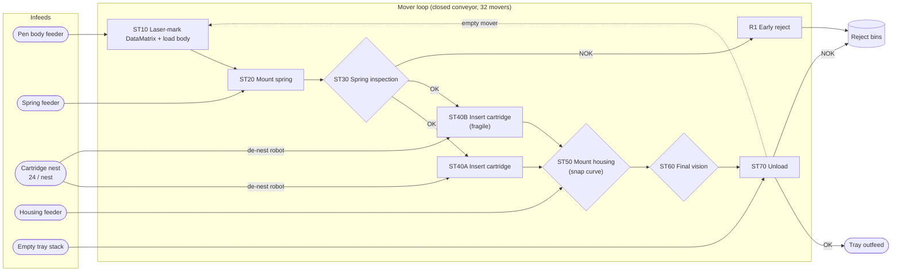
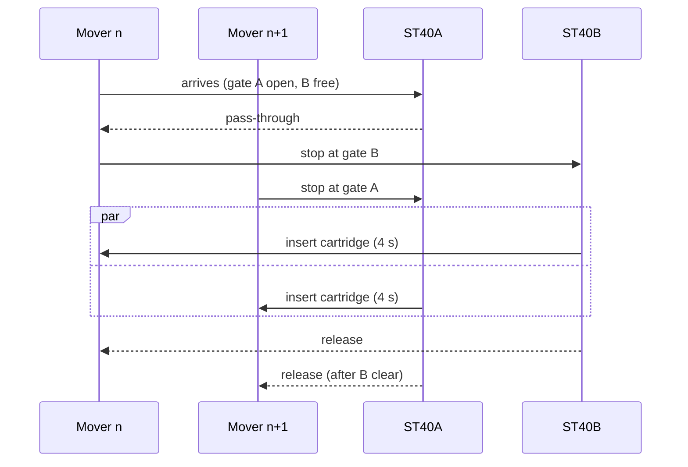
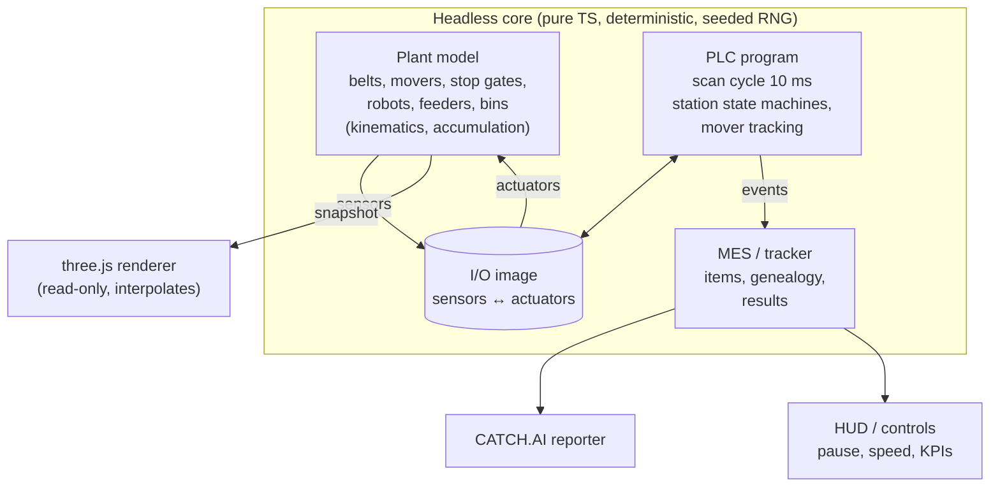
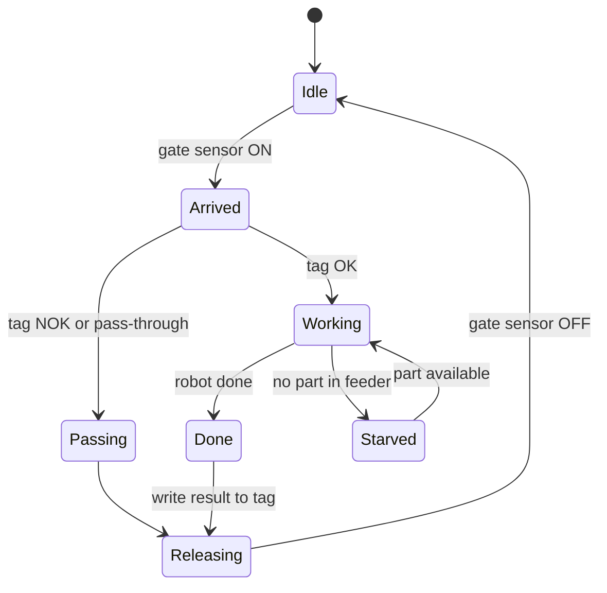
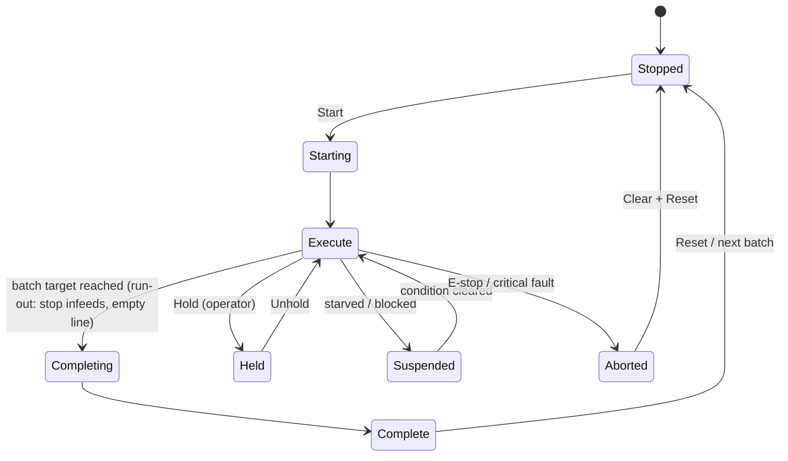
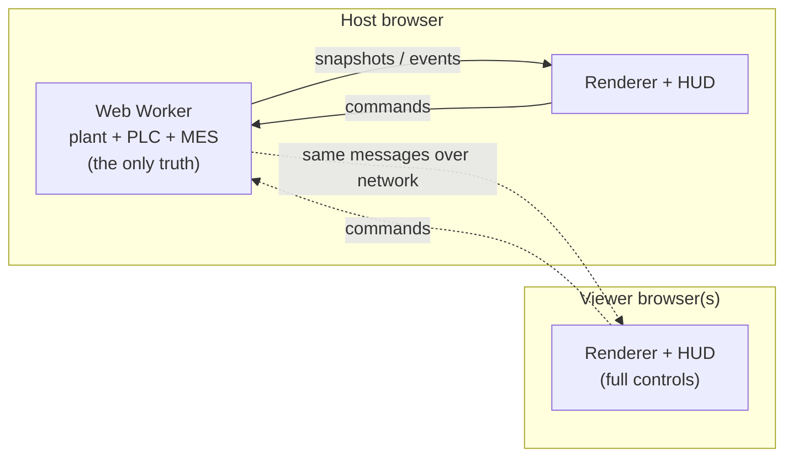
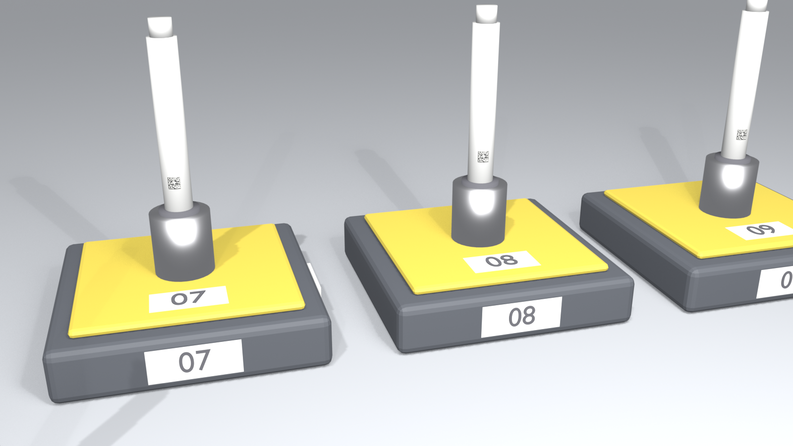

# Pen Assembly Line Simulator — Plan (draft v0.2)

## 0. Decisions so far

- **Product:** pen injector, same domain as the C# simulator.
- **Browser-only app**, with no backend. It is designed so that later one browser can run the simulation while others watch and control it, e.g. speed and start/stop (§9).
- **Real time only.** The HMI has a **machine speed override**, like a real line (§8).
- **Reporting:** a REST API (CATCH.AI). Details will come when we reach that milestone.
- **Faults and batches:** wanted. The state model is designed for them from day one; implementation comes after the core runs (§8).
- **Movers:** 32, each numbered, with individual physical differences (§6).
- **IDs:** every item gets a scoped id (shift register id). The pen body additionally gets a long unique **identifier** (GS1-style serial), laser-marked as a GS1 DataMatrix (§7).

A three.js simulation of a pharma (pen-injector) assembly line. Unlike the .NET
`IrAssemblySimulatorService` (see `inspiration/`), nothing teleports: parts and
carriers **physically move** on belts, wait at stop gates, queue behind each
other and are picked by robots whose motion takes real time. Cycle times
*emerge* from belt speed, distances, accumulation and station process times.

## 1. What we keep from the C# simulator

| Concept | C# | Here |
| --- | --- | --- |
| Item genealogy | `ItemProcessed`, `ItemsMerged`, ScopedId | Same events, but `From`/`To` are real sim times |
| Unpack 1 → N | De-nest 1 nest → 160 cartridges | Nest of 24 cartridges, robot picks one at a time |
| Pack N → 1 | 32 pens → 1 tray | 12 pens → 1 tray (3×4) |
| Carriers | 32 Movers, recycled | 32 numbered movers on a closed loop, recycled |
| Parallel stations | EM14A–D | ST40A/ST40B on the same belt (twin station) |
| Fragile station | EM14B drifts values | ST40B drifts downstream measurements |
| Bad carriers | IDs 2, 6, 24 drift | Every mover has its own physical profile; a few are clearly worn (§6) |
| Inspections | Normal dist. vs LSL/USL | Same, plus snap curve at housing mount |

What we drop for v1: label assembly/inspection, spring-base rotation, the
separate housing sub-line, tray inspection, and four-way parallelism.

## 2. Simplified line



**Reject strategy (target ≈ 5 %).** Inspections don't move parts themselves.
They write OK/NOK to the mover's tag, as a real line does with RFID. Downstream
stations read the tag and skip NOK movers. Physical removal happens at two
reject stations:

- **R1, early reject** right after ST30, so we don't waste an expensive cartridge on a bad spring.
- **ST70 unload** sends a NOK part to the reject bin instead of the tray.

| Inspection | Rate | Cause |
| --- | --- | --- |
| ST30 spring | ~2 % | spring angle / missing |
| ST50 snap | ~1 % | snap force / position out of window |
| ST60 final | ~2 % | cartridge seating, cosmetic |

## 3. Parallel twin station (ST40A / ST40B)

Both stations sit on the same belt with one stop gate each. Inserting a
cartridge is slow (~4 s), while the takt is ~2 s, so they work in pairs:

1. Mover *n* arrives at ST40A. The PLC sees ST40B is free, so ST40A **passes it through**.
2. Mover *n* stops at ST40B, and mover *n+1* stops at ST40A.
3. Both stations process **at the same time**.
4. B releases first (downstream); A releases when the gap is clear.

This produces overlapping `ItemProcessed` intervals on two devices for
consecutive items, which is the feature we want to exercise in our product.
NOK movers (from ST30) pass both stations. Later option: a real **split/merge**
with a diverter onto two lanes.



## 4. Architecture — plant / PLC / views

The core rule: **the simulation is the truth and the renderer only looks at it.**



- **Plant** advances in fixed steps (e.g. 1 ms). Movers sit on a belt path. Each one moves at belt speed unless a stop gate or the mover in front blocks it, in which case the belt slips underneath, like a pallet conveyor. Robots move their axes with max speed and acceleration, so each pick-and-place takes real time.
- **I/O image**: the only interface between the plant and the PLC. Inputs are photo-eyes, gate-occupied sensors, RFID reads and robot done-bits. Outputs are gate open/close, robot start and belt run.
- **PLC** runs station state machines on a 10 ms scan. It never touches plant positions directly.
- **MES** turns PLC events into `ItemProcessed` / `ItemsMerged` records with real timestamps.
- **Renderer** reads the plant state every frame and never mutates it. Because the core is headless, the line can also run in tests, faster than real time.

Station state machine (each assembly station):



## 5. Timing budget (first guess)

Belt speed 0.25 m/s, mover pitch 0.15 m, loop ≈ 10 m, target takt ≈ 2.0 s
(30 pens/min) at 100 % machine speed.

| Station | Process | Effective |
| --- | --- | --- |
| ST10 load | 1.5 s | 1.5 s |
| ST20 spring | 1.6 s | 1.6 s |
| ST30 inspect | 0.8 s | 0.8 s |
| ST40A/B cartridge | 4.0 s | 2.0 s (×2) |
| ST50 housing | 1.8 s | 1.8 s |
| ST60 vision | 1.0 s | 1.0 s |
| ST70 unload | 1.5 s | 1.5 s |

Travel and indexing (accelerating/decelerating at the gate) add on top. The
twin station is the bottleneck by design, so you'll see queues build in front
of it.

**Why 32 movers.** By Little's law, the number of movers needed = throughput ×
loop time. One lap takes about 57 s: 40 s of travel, 12 s of station dwell and
about 4.5 s of indexing. That gives:

| Movers | Max throughput |
| --- | --- |
| 24 | ~25 pens/min, so movers become the bottleneck |
| **32** | **~34 pens/min, which leaves a small queue at ST40** |
| 40 | ~42 pens/min |

32 matches the C# simulator. The count is configurable, and with too few
movers you can watch the line starve, which is realistic.

## 6. Movers — numbered and individually different

Each mover has a number (01–32) on top and on both long sides, and an RFID tag
on its leading face. A mover's physical profile is generated from a seed, so it
stays the same across runs. A few movers are deliberately worn:

| Property | Normal range | Effect in the sim | Worn example |
| --- | --- | --- | --- |
| Drive-pad friction | μ 0.30–0.35 | Acceleration after a gate opens, so indexing takes longer | #06: μ 0.18, sluggish |
| Belt slip | 0–2 % | Cruise speed below belt speed, so travel takes longer | #19: 6 % slip |
| Stop settle time | 80–150 ms | Station waits for "in position" before starting | #11: 350 ms, bounces |
| Fixture offset | ±0.05 mm | Bias on measurements (spring angle, snap position, vision) | #24: 0.4 mm, more rejects |
| RFID read | 99.9 % first read | Each retry costs 300 ms; 3 failures → "no read" → item NOK | #02: flaky tag, 5 % retries |
| Wear over time | slow drift per lap | Friction and offset degrade slowly | — |

The differences show up both in **timing** (some movers lap more slowly) and in
**quality** (some movers are rejected more often). Our product should be able to
find both. Clicking a mover in 3D opens its profile, lap count, last lap time
and reject history.

## 7. Item identity — scoped id / shift register id

- Every item that enters the line gets a **scoped id** (SR id), one sequence per line, as in the C# sim. This covers pen bodies, springs, cartridges, nests, housings, caps and trays.
- **On the mover loop**, the item's SR id is written to the mover's RFID tag. Each station reads the tag, so the PLC tracks by mover. Tracking by mover is what lets mover numbers appear in the data.
- **On plain conveyors** (feeder tracks, tray outfeed, reject chutes), the PLC uses classic **shift registers**. Each time an item passes a sensor, its SR id shifts one slot along with it.
- **Identifier ≠ SR id.** Like `AddIdentifier`/`ItemIdentifier` at EM31 in the C# sim, a product also gets a long, unique **identifier**. This is the code printed or marked on the product; the SR id is only the line's internal tracking key. The station that applies the identifier reports it once as `ItemIdentifier` on its `ItemProcessed`, which links the two. After that, everything is tracked by SR id.
- **The pen body is laser-marked at ST10** with a **GS1 DataMatrix** of its identifier (6 × 6 mm, just above the mover fixture). That is the standard for medicines (EU FMD / US DSCSA) and for direct part marking. Content: `(01)` GTIN + `(17)` expiry + `(10)` batch + `(21)` unique serial. The fixed-length fields go first and the serial last, so only one FNC1 separator is needed. Example: `(01)05712345000014(17)291114(10)B261114(21)A7K2P9X4Q1RZ`. ST60 reads the code, resolves the identifier to its SR id and compares it with the mover's tag. A mismatch or unreadable code makes the item NOK ("ID mismatch / no read").
- **Genealogy:** at merge stations (spring, cartridge, housing, tray) the PLC emits `ItemsMerged` with the source and target SR ids. The pen keeps the pen body's identifier as its identity.
- **In 3D**, DataMatrix codes are drawn at runtime (`bwip-js`) from the real identifier. The HUD shows both ids.

## 8. Machine speed, states, faults and batches

**Speed override (HMI): 10–100 %.** It scales belt speed, robot axis speeds and
mechanical process times. Fixed physical times (vision exposure, a minimum snap
dwell) don't scale. The sim clock always runs in real time; only the machine
gets slower or faster. A real line ramps when the speed changes, so ours does
too.

**Machine states** (PackML-inspired) are built into the PLC from the start, so
faults and batches don't have to be retrofitted later:



Each station also reports its own status: *Working, Waiting for part (starved),
Blocked, Fault, Passing*. That feeds OEE and availability per station.

**Faults** (each with MTBF/MTTR and a recovery delay, like an operator walking over):

- Feeder jam at the body or spring bowl: the station starves and the operator clears it after about 20–60 s.
- Cartridge nest empty: nest change takes about 15 s, and the twin station starves.
- Empty-tray stack empty or outfeed full: ST70 is blocked and the loop backs up.
- Gripper drop: the part is lost, and the next inspection finds it missing (NOK).
- Mover RFID no-read (§6).
- Station fault: an axis error or similar, cleared with a reset.

**Batches:** a batch has a name, a target quantity, a start, run-out and complete.
Batches map to the "Assembly Batch" period in CATCH.AI, as in the C# sim.

## 9. Shared viewing — one host, many viewers

Not built now, but the core is laid out so that adding it later is easy:



Rules we follow from day one:

1. **The sim runs in a Web Worker**, even when there is only one browser. Hidden tabs stop `requestAnimationFrame` and heavily throttle main-thread timers, which would stop a "real-time" line whenever the host tab is in the background. A worker keeps it running. It also forces a clean message boundary.
2. **All simulation state is plain serializable data**: no three.js objects and no closures in the state.
3. **One protocol:**
   - `snapshot`: full state when a client joins.
   - `frame`: positions and states at about 30 Hz.
   - `event`: item processed or merged, faults, state changes.
   - `command`: start, stop, speed, hold.

   The local renderer uses exactly the same messages a remote viewer would.
4. **The renderer interpolates** between frames, with about 100 ms of delay. That makes motion smooth locally and over a network alike.
5. **Every client can control the line**, viewers included: start/stop, hold, speed and future features. A command is a request to the host, and only the host applies it. The host checks it against the current machine state (e.g. no Start while Aborted) and puts the result in the state everyone receives. No client changes its own copy, so all screens always agree. Each command carries its origin (client id/name) and goes into an operator log, like an HMI audit trail. New features only need a new command type and a handler in the worker.
6. **Transport later:** a few options, decided when we get there.
   - BroadcastChannel: free, for tabs on the same PC.
   - WebRTC DataChannel: peer-to-peer, but needs a tiny signaling step.
   - A minimal WebSocket relay.

## 10. 3D models (Blender → glTF)

Models are generated by **Python scripts** run headless
(`blender -b -P tools/blender/<name>.py`). That makes them reproducible and
reviewable in git. They export `.glb` to `public/models/`. Belts and frames
whose length depends on the layout stay **procedural in three.js**.

| Asset | Source | Notes |
| --- | --- | --- |
| Pen body, spring, cartridge, housing, assembled pen | Blender | Real-ish proportions, ~16 mm Ø pen; body has a UV-mapped `dm_mark` patch |
| Mover with pen fixture | Blender | `label_top` / `label_side_a/b` planes; numbers painted at runtime |
| Cartridge nest, tray (3×4) | Blender | |
| Station frame, vision tunnel, gantry pick-and-place | Blender | Robots get separate nodes per axis, animated by the sim |
| Reject bin, feeders (vibratory bowl, linear track) | Blender | |
| Conveyor straights/curves, floor, guards | three.js | Parametric |

We approve models from preview renders before wiring them in.
Regenerate the renders with:

```sh
node tools/scripts/dm-png.mjs "(01)05712345000014(17)291114(10)B261114(21)A7K2P9X4Q1RZ" /tmp/pv/dm.png
blender -b -P tools/blender/parts.py -- /tmp/pv /tmp/pv/dm.png
```




## 11. Milestones

1. **Plan & models**: this document plus first Blender part set, reviewed together.
2. **Headless core in a Web Worker**: plant (belt, 32 movers, gates), PLC with machine states, ST10 → ST70 as timed stations, SR ids, speed override, and the snapshot/frame protocol. Tests for accumulation, throughput and mover differences.
3. **3D view**: orbit camera, procedural loop, movers with numbers, interpolation from frames.
4. **Real stations**: robots, feeders, de-nesting, laser marking and DataMatrix, tray packing, reject bins.
5. **Twin station + quality**: ST40A/B pairing, fragile drift, mover profiles, snap curve, ~5 % rejects.
6. **Faults and batches**: MTBF/MTTR faults, starved/blocked, batch run-out.
7. **Reporting**: MES events to the CATCH.AI REST API (details from you).
8. **HUD**: KPIs (throughput, OEE, reject %), mover inspector, follow camera, timeline.
9. **Shared viewing**: transport for the existing protocol.

## 12. Open questions

- CATCH.AI REST details, needed at milestone 7.
