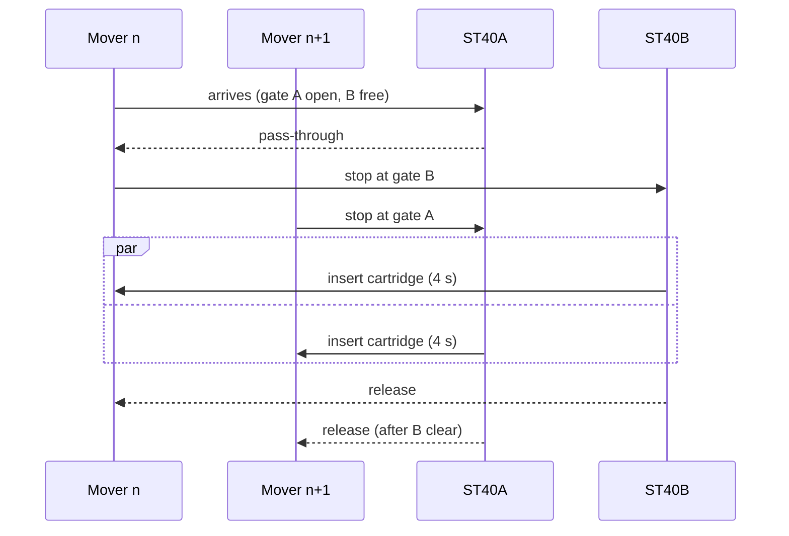
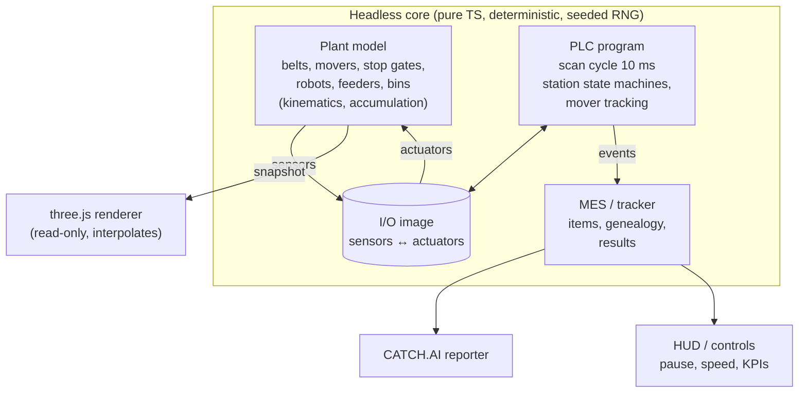
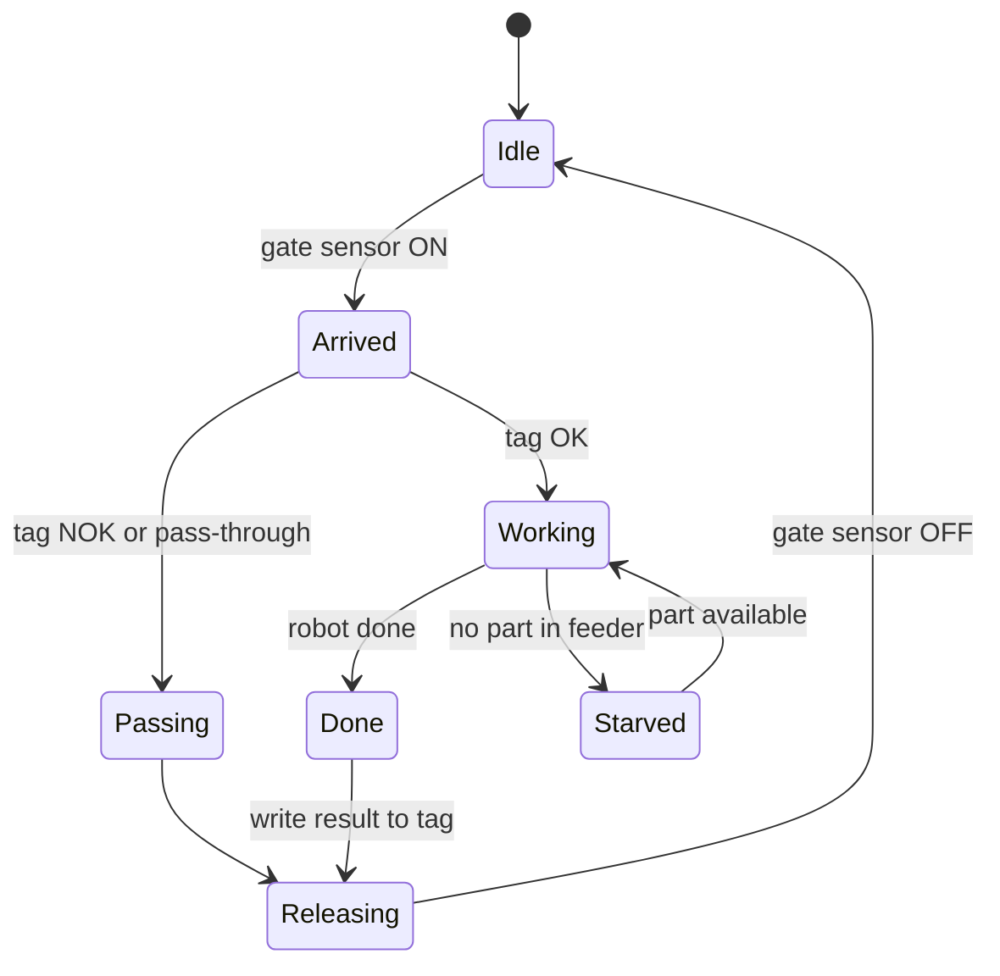
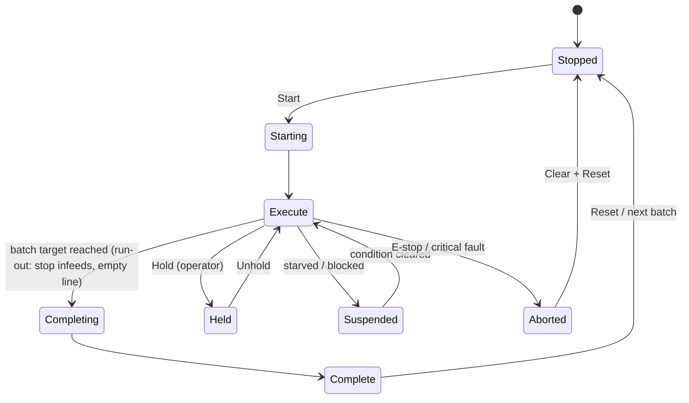
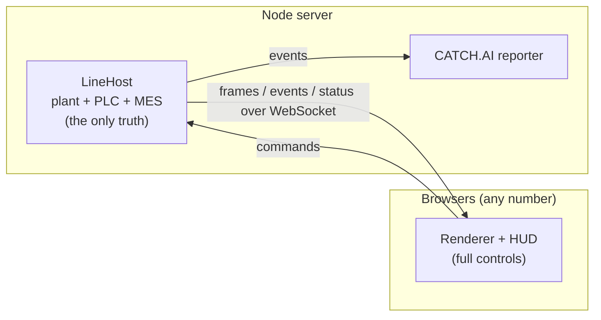
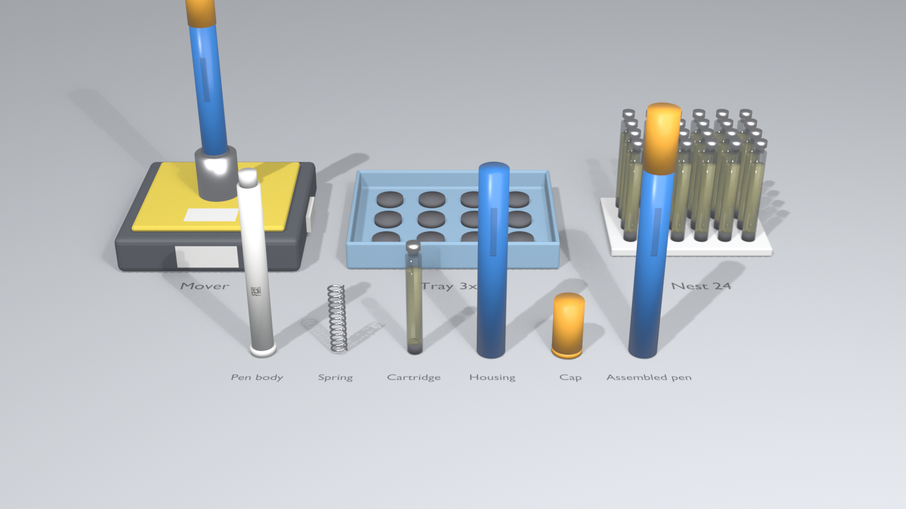

# Pen Assembly Line Simulator — Plan (draft v0.2)

## 0. Decisions so far

- **Product:** pen injector, same domain as the C# simulator.
- **Browser-only app**, with no backend. It is designed so that later one browser can run the simulation while others watch and control it, e.g. speed and start/stop (§9).
- **Real time only.** The HMI has a **machine speed override**, like a real line (§8).
- **Reporting:** the CATCH.AI REST API (§10d).
- **Faults and batches:** wanted. The state model is designed for them from day one; implementation comes after the core runs (§8).
- **Movers:** 32, each numbered, with individual physical differences (§6).
- **IDs:** every item gets a scoped id (shift register id). The pen body additionally gets a long unique **identifier** (GS1-style serial), laser-marked as a GS1 DataMatrix (§7).

A three.js simulation of a pharma (pen-injector) assembly line. Unlike the .NET
`IrAssemblySimulatorService` (see `inspiration/`), nothing teleports: parts and
carriers **physically move** on belts, wait at stop gates, queue behind each
other and are picked by robots whose motion takes real time. Cycle times
*emerge* from belt speed, distances, accumulation and station process times.

## 1. What we keep from the C# simulator

| Concept | C# | Here |
| --- | --- | --- |
| Item genealogy | `ItemProcessed`, `ItemsMerged`, ScopedId | Same events, but `From`/`To` are real sim times |
| Unpack 1 → N | De-nest 1 nest → 160 cartridges | Nest of 24 cartridges, robot picks one at a time |
| Pack N → 1 | 32 pens → 1 tray | 12 pens → 1 tray (3×4) |
| Carriers | 32 Movers, recycled | 32 numbered movers on a closed loop, recycled |
| Parallel stations | EM14A–D | ST40A/ST40B on the same belt (twin station) |
| Fragile station | EM14B drifts values | ST40B drifts downstream measurements |
| Bad carriers | IDs 2, 6, 24 drift | Every mover has its own physical profile; a few are clearly worn (§6) |
| Inspections | Normal dist. vs LSL/USL | Same, plus snap curve at housing mount |

What we drop for v1: label assembly/inspection, spring-base rotation, the
separate housing sub-line, tray inspection, and four-way parallelism.

## 2. Simplified line


**Reject strategy (target ≈ 5 %).** Inspections don't move parts themselves.
They write OK/NOK to the mover's tag, as a real line does with RFID. Downstream
stations read the tag and skip NOK movers. Physical removal happens at two
reject stations:

- **R1, early reject** right after ST30, so we don't waste an expensive cartridge on a bad spring.
- **ST70 unload** sends a NOK part to the reject bin instead of the tray.

| Inspection | Rate | Cause |
| --- | --- | --- |
| ST30 spring | ~2 % | spring angle / missing |
| ST50 snap | ~1 % | snap force / position out of window |
| ST60 final | ~2 % | cartridge seating, cosmetic |

## 3. Parallel twin station (ST40A / ST40B)

Both stations sit on the same belt with one stop gate each. Inserting a
cartridge is slow (~4 s), while the takt is ~2 s, so they work in pairs:

1. Mover *n* arrives at ST40A. The PLC sees ST40B is free, so ST40A **passes it through**.
2. Mover *n* stops at ST40B, and mover *n+1* stops at ST40A.
3. Both stations process **at the same time**.
4. B releases first (downstream); A releases when the gap is clear.

This produces overlapping `ItemProcessed` intervals on two devices for
consecutive items, which is the feature we want to exercise in our product.
NOK movers (from ST30) pass both stations. Later option: a real **split/merge**
with a diverter onto two lanes.



## 4. Architecture — plant / PLC / views

The core rule: **the simulation is the truth and the renderer only looks at it.**



- **Plant** advances in fixed steps (e.g. 1 ms). Movers sit on a belt path. Each one moves at belt speed unless a stop gate or the mover in front blocks it, in which case the belt slips underneath, like a pallet conveyor. Robots move their axes with max speed and acceleration, so each pick-and-place takes real time.
- **I/O image**: the only interface between the plant and the PLC. Inputs are photo-eyes, gate-occupied sensors, RFID reads and robot done-bits. Outputs are gate open/close, robot start and belt run.
- **PLC** runs station state machines on a 10 ms scan. It never touches plant positions directly.
- **MES** turns PLC events into `ItemProcessed` / `ItemsMerged` records with real timestamps.
- **Renderer** reads the plant state every frame and never mutates it. Because the core is headless, the line can also run in tests, faster than real time.

Station state machine (each assembly station):



## 5. Timing (measured in the headless sim)

Belt speed 0.25 m/s, mover length 0.12 m, loop ≈ 9.7 m, at 100 % machine speed.

| Station | Process (scales with speed + fixed) |
| --- | --- |
| ST10 laser mark + load | 1.2 + 0.3 s |
| ST20 spring | 1.6 s |
| ST30 inspect | 0.3 + 0.5 s |
| R1 reject (NOK only) | 1.0 s |
| ST40A/B cartridge | 4.0 s each, 0.25 m apart |
| ST50 housing + cap (snap) | 1.8 s |
| ST60 vision + DataMatrix | 0.4 + 0.6 s |
| ST70 unload | 1.5 s |

**Lesson from the first runs: indexing is expensive.** Every stop costs about
0.9 s on top of the process time:
- moving up one mover pitch from the queue,
- accelerating with friction,
- settling at the gate,
- reading the RFID tag (40 ms) and writing it back.

So even with no bottleneck at all, the line tops out at about 23 pens/min. The
original 2 s takt (30/min) wasn't physically possible, which is exactly the
kind of thing this simulator should expose.

Results from 60 simulated minutes, several seeds:

- **≈ 22 pens/min.** The twin station is the bottleneck, with a queue in front of it.
- **ST40A/ST40B split ≈ 50/50**, and over 80 % of their cycles overlap in time.
  - The gap between them matters: at 0.5 m the pair reaches only ~18/min, because passing a mover through A to B takes 2 s.
  - A single ST40 alone gives ~16/min.
- **Rejects ≈ 3.7–6 % (≈ 4.8 % average).** ST40B (fragile) visibly raises seating-depth rejects, and worn mover #24 is rejected more often.

**Why 32 movers.** By Little's law, the number of movers needed = throughput ×
loop time. One lap takes about 57 s without queues: 40 s of travel, 12 s of station dwell and
about 4.5 s of indexing. That gives:

| Movers | Max throughput |
| --- | --- |
| 24 | ~25 pens/min, so movers become the bottleneck |
| **32** | **~34 pens/min, which leaves a small queue at ST40** |
| 40 | ~42 pens/min |

32 matches the C# simulator. The count is configurable, and with too few
movers you can watch the line starve, which is realistic.

## 6. Movers — numbered and individually different

Each mover has a number (01–32) on top and on both long sides, and an RFID tag
on its leading face. A mover's physical profile is generated from a seed, so it
stays the same across runs. A few movers are deliberately worn:

| Property | Normal range | Effect in the sim | Worn example |
| --- | --- | --- | --- |
| Drive-pad friction | μ 0.115–0.125 | Acceleration after a gate opens, so indexing takes longer | #06: μ 0.06, sluggish |
| Belt slip | 0–2 % | Cruise speed below belt speed, so travel takes longer | #19: 6 % slip |
| Stop settle time | 80–150 ms | Station waits for "in position" before starting | #11: 350 ms, bounces |
| Fixture offset | ±0.05 mm | Bias on measurements (spring angle, snap position, vision) | #24: 0.4 mm, more rejects |
| RFID read | 99.9 % first read | Each retry costs 300 ms; 3 failures → "no read" → item NOK | #02: flaky tag, 5 % retries |
| Wear over time | slow drift per lap | Friction and offset degrade slowly | — |

The differences show up both in **timing** (some movers lap more slowly) and in
**quality** (some movers are rejected more often). Our product should be able to
find both. Clicking a mover in 3D opens its profile, lap count, last lap time
and reject history.

## 7. Item identity — scoped id / shift register id

- Every item that enters the line gets a **scoped id** (SR id), one sequence per line, as in the C# sim. This covers pen bodies, springs, cartridges, nests, housings, caps and trays.
- **On the mover loop**, the item's SR id is written to the mover's RFID tag. Each station reads the tag, so the PLC tracks by mover. Tracking by mover is what lets mover numbers appear in the data.
- **On plain conveyors** (feeder tracks, tray outfeed, reject chutes), the PLC uses classic **shift registers**. Each time an item passes a sensor, its SR id shifts one slot along with it.
- **Identifier ≠ SR id.** Like `AddIdentifier`/`ItemIdentifier` at EM31 in the C# sim, a product also gets a long, unique **identifier**. This is the code printed or marked on the product; the SR id is only the line's internal tracking key. The station that applies the identifier reports it once as `ItemIdentifier` on its `ItemProcessed`, which links the two. After that, everything is tracked by SR id.
- **The pen body is laser-marked at ST10** with a **GS1 DataMatrix** of its identifier (6 × 6 mm, just above the mover fixture). That is the standard for medicines (EU FMD / US DSCSA) and for direct part marking. Content: `(01)` GTIN + `(17)` expiry + `(10)` batch + `(21)` unique serial. The fixed-length fields go first and the serial last, so only one FNC1 separator is needed. Example: `(01)05712345000014(17)291114(10)B261114(21)A7K2P9X4Q1RZ`. ST60 reads the code, resolves the identifier to its SR id and compares it with the mover's tag. A mismatch or unreadable code makes the item NOK ("ID mismatch / no read").
- **Genealogy:** at merge stations (spring, cartridge, housing, tray) the PLC emits `ItemsMerged` with the source and target SR ids. The pen keeps the pen body's identifier as its identity.
- **In 3D**, DataMatrix codes are drawn at runtime (`bwip-js`) from the real identifier. The HUD shows both ids.

## 8. Machine speed, states, faults and batches

**Speed override (HMI): 10–100 %.** It scales belt speed, robot axis speeds and
mechanical process times. Fixed physical times (vision exposure, a minimum snap
dwell) don't scale. The sim clock always runs in real time; only the machine
gets slower or faster. A real line ramps when the speed changes, so ours does
too.

**Machine states** (PackML-inspired) are built into the PLC from the start, so
faults and batches don't have to be retrofitted later:



Each station also reports its own status: *Working, Waiting for part (starved),
Blocked, Fault, Passing*. That feeds OEE and availability per station.

**Faults** (each with MTBF/MTTR and a recovery delay, like an operator walking over):

- Feeder jam at the body or spring bowl: the station starves and the operator clears it after about 20–60 s.
- Cartridge nest empty: nest change takes about 15 s, and the twin station starves.
- Empty-tray stack empty or outfeed full: ST70 is blocked and the loop backs up.
- Gripper drop: the part is lost, and the next inspection finds it missing (NOK).
- Mover RFID no-read (§6).
- Station fault: an axis error or similar, cleared with a reset.

**Batches:** a batch has a name, a target quantity, a start, run-out and complete.
Batches map to the "Assembly Batch" period in CATCH.AI, as in the C# sim.

## 9. Shared viewing: one host, many viewers (built)

The simulation runs on the Node server (`src/server`), and every browser is a viewer over a
WebSocket at `/ws`:



Rules:

1. **The sim runs on the server.** It first ran in a Web Worker in the browser, so hidden tabs wouldn't stop it. The worker also forced a clean message boundary. Moving it to the server kept that boundary and the protocol as they were, and the line now runs without any browser open.
2. **All simulation state is plain serializable data**: no three.js objects and no closures in the state.
3. **One protocol** (`src/sim/protocol.ts`), as JSON text frames:
   - On connect: the current `frame`, the last 200 events and the reporter status. A frame holds everything a viewer needs to draw, so there's no separate join snapshot. `snapshot` (the full state) is still there on request for debugging.
   - `frame`: positions and states at about 30 Hz, with the `events` since the previous frame just before it.
   - `command`: start, stop, speed, hold, batch settings, fault injection.

   Each message is serialized once for all viewers. Frames can be dropped: a viewer whose socket is backed up skips frames instead of falling further behind.
4. **The renderer interpolates** between frames, with about 150 ms of delay to absorb network jitter. After a reconnect it drops its buffer, because the server may have restarted with sim time back at 0.
5. **Every viewer can control the line.** A command is a request to the host, and only the host applies it. The host checks it against the current machine state (e.g. no Start while Aborted) and puts the result in the state everyone receives. No client changes its own copy, so all screens always agree. Each command carries its origin (client name) and goes into an operator log, like an HMI audit trail. The server validates every incoming message and drops anything that doesn't match the protocol.
6. **One server process is one line.** The state lives in memory, and a restart starts a fresh line.

## 10. 3D models (Blender → glTF)

Models are generated by **Python scripts** run headless
(`blender -b -P tools/blender/<name>.py`). That makes them reproducible and
reviewable in git. They export `.glb` to `public/models/`. Belts and frames
whose length depends on the layout stay **procedural in three.js**.

| Asset | Source | Notes |
| --- | --- | --- |
| Pen body, spring, cartridge, housing, assembled pen | Blender | Real-ish proportions, ~16 mm Ø pen; body has a UV-mapped `dm_mark` patch |
| Mover with pen fixture | Blender | `label_top` / `label_side_a/b` planes; numbers painted at runtime |
| Cartridge nest, tray (3×4) | Blender | |
| Station frame, vision tunnel, gantry pick-and-place | Blender | Robots get separate nodes per axis, animated by the sim |
| Reject bin, feeders (vibratory bowl, linear track) | Blender | |
| Conveyor straights/curves, floor, guards | three.js | Parametric |

We approve models from preview renders before wiring them in. The app loads
`public/models/*.glb`. Regenerate them with
`blender -b -P tools/blender/parts.py -- public --no-render`.
Regenerate the renders with:

```sh
node tools/scripts/dm-png.mjs "(01)05712345000014(17)291114(10)B261114(21)A7K2P9X4Q1RZ" /tmp/pv/dm.png
blender -b -P tools/blender/parts.py -- /tmp/pv /tmp/pv/dm.png
```




## 10b. Station mechanics (built in milestone 4)

- **Robots:** three-axis cartesian gantries (along belt, across belt, up/down) with velocity/acceleration limits that scale with machine speed. Like a robot controller, a robot runs jobs the PLC starts (`prepick`, `place`, `pickMover`, `drop`) and reports back when done.
- **Pre-picking:** loading stations fetch the next part while the mover is still indexing. Feeders sit on stands at near-travel height, so a fetch takes about 1.3 s.
- **Feeders:** bowl feeders push parts onto linear tracks where they queue up. An empty track **starves** the station: the stack light shows blue, and the HUD shows the station as starved.
- **Cartridge nests:** each twin station has its own nest of 24, and each pick goes to a specific pocket. When a nest is empty, a nest change takes 4 s. The robot's pre-picked spare covers that, but a slower change starves the station.
- **Part geometry:** one table in the config (`LINE.parts`) says where each part sits in the finished pen and how long it is. Robots, feeders and the 3D view all derive heights from it. The pen body is a translucent open tube, the spring and cartridge go inside it, and the housing slides over it. Grippers hold every part, and every pen, by its top.
- **Insertion:** a robot brings the part to an approach height above the mover, then pushes it home over the station's press time (`insert` stroke, `mech` seconds). It doesn't hover and then swap models.
- **Rejects and tray:** R1 and ST70 pick the pen off the mover and drop it in a bin, or place it in a tray pocket. The pen counts as output the moment it is let go. A full tray indexes out in 3 s, during which ST70 is **blocked**. Filled trays then queue on the outfeed conveyor.
- **Interlocks:** nest and tray changes only start once the robot's gripper is back up at safe height.
- **Laser marking:** the DataMatrix only exists on the body after the laser dwell, and ST60 reads what was physically marked. The code faces the inner side of the loop, where the laser head and ST60's side reader are. It stays visible through a code window in the housing.
- **Tests:** axis limits, pre-pick timing, feeder starvation, nest/tray changes, and part conservation (every body that leaves the feeder is accounted for).

## 10c. Faults and batches (built in milestone 6)

- **Feeder jams:** each part fed has a 1/450 chance of jamming the bowl. A jammed bowl stops feeding until it's cleared after 20–60 s. The track drains, then the station starves.
- **Twin station:** ST40A only passes a mover on to ST40B when B is free and not faulted.
- **Robot axis faults:** these are based on operating time, with a 30-min mean time between faults per robot (about 7–8 per hour across the line). The robot freezes and the station shows *fault* until it's repaired after 30–90 s. The queue behind it builds.
- **Misplaced parts:** 0.3 % of placed parts don't seat and end up as scrap on the table. The tag still says the step was done, so a later inspection rejects the pen as **Part missing**. This is a realistic mismatch between what the PLC believes and what is physically there.
- **Fault injection:** a `fault` command that any client can send to trigger an axis fault on any robot or a jam on any feeder.
- **Batches:** a batch has a target number of pens *loaded*. When it's reached, the machine goes **Completing**: ST10 stops loading (and stops pre-picking bodies) and the line runs empty. The last, part-filled tray is closed and sent out, so batches never share a tray. Once every robot has finished its job, the machine goes **Complete**, and after a 20 s pause the next batch starts automatically. The batch size and auto-next can be set from the HUD, and a batch can be ended early. Batches are named `yyyyMMddHHmmss` and emit started/completed events (for CATCH.AI periods).
- With default faults, throughput drops visibly compared with a clean line; the tests check it stays above 60 % of clean.

## 10d. CATCH.AI reporting (built in milestone 7)

The reporter (`src/catchai`) runs on the server next to the sim and calls CATCH.AI directly with
`CATCHAI_API_KEY`. The key never reaches a browser, and there are no CORS issues. (When the sim ran
in the browser, this needed a proxy.) With a key, reporting is on from startup. The **CATCH.AI**
button in the top bar turns it on/off for the whole line, and its tooltip shows counts and errors.

**Setup before any data** (idempotent, on every start):

| What | Ours |
| --- | --- |
| Devices | `L07` (line) with children: every station, feeder (`L07-SPRINGS`, …), nest (`L07-ST40A-NEST`), `L07-ST70-TRAY` and the ST70 reject bin `L07-ST70-REJECT` |
| Period type | "Assembly Batch"; each batch is a period on `L07` |
| Scope | `L07`, tied to the batch period type. The server only takes items inside an open batch period |
| Processes | Stations: item type Pen, carrier type Mover, `HasResult` where they inspect, source type = part they merge. Feeders: Spring / Housing. Nests: Cartridge from Nest. Tray packing: Tray from Pen. ST70 reject bin: Pen on a Mover, so rejects at the outfeed are kept apart from the packed pens on `L07-ST70` |
| Properties / events | Keys must be `p<n>` / `e<n>` and are shared with other systems on the server, so ours are tagged `Mappings: { L07: name }` and new ones take the next free number |
| Item view | "L07 Pen genealogy": Spring/Housing/Cap/Cartridge → Pen, Nest → Cartridge, Pen → Tray (one relation per type pair, so the twin ST40s share one) |

**What is sent:**

- `ItemProcessed` whenever an item is at a station: the pen at every station (with its GS1 identifier and mover number as carrier, and `ItemResult` where inspected: Failed 0, Passed 1), each part at its feeder or nest (cartridges with their nest as source item and position), the tray when it leaves.
- `ItemsMerged` whenever two items are put together: each part into the pen, each good pen into the tray (with its tray position).
- Device data: inspection values and limits (also under their own names: Spring Angle, Snap Force, Seat Depth), reject cause, code read, tray position/count, mover id, item scoped id; machine state; events for state changes, commands, batches, robot faults, feeder jams and RFID problems.
- Periods: a batch's period opens at its start and closes at its completion. A period left open by an earlier session is closed when the next one starts.

Server behaviour the reporter relies on (found by probing the demo server):

- Only one item record per (process, timestamp), and one device data row per (device, timestamp). Duplicates are dropped silently, even though the API reports success. The housing and cap placed in the same cycle would collide, so every timestamp is made unique per process/device by moving it on by 1 ms when needed.
- Scoped ids must be unique within the scope across sessions. Each session reports `sim id + base`, where base is the highest id among the most recent items in the scope.
- Bulk endpoints (`/api/v2/...`) answer per entry. Refused entries are counted and not retried. Network errors, 5xx and auth errors keep the queue and retry with backoff.

Requests go in order, with batch boundaries as barriers. Within a stretch, items go first, then merges, then device data, in bulk requests of up to 500.

## 11. Milestones

1. ✅ **Plan & models**: this document plus first Blender part set, reviewed together.
2. ✅ **Headless core** (first in a Web Worker, now on the server): plant (belt, 32 movers, gates), PLC with machine states, ST10 → ST70 as timed stations, SR ids, speed override, and the snapshot/frame protocol. Tests for accumulation, throughput and mover differences.
3. ✅ **3D view**: orbit camera, procedural loop, movers with numbers, interpolation from frames.
4. ✅ **Real stations**: robots, feeders, de-nesting, laser marking and DataMatrix, tray packing, reject bins.
5. **Twin station + quality**: ST40A/B pairing, fragile drift, mover profiles, snap curve, ~5 % rejects.
6. ✅ **Faults and batches**: MTBF/MTTR faults, starved/blocked, batch run-out.
7. ✅ **Reporting**: MES events to the CATCH.AI REST API (§10d).
8. **HUD**: KPIs (throughput, OEE, reject %), mover inspector, follow camera, timeline.
9. ✅ **Shared viewing**: simulation on a Node server, streamed to every browser over WebSocket (§9).

## 12. Open questions

